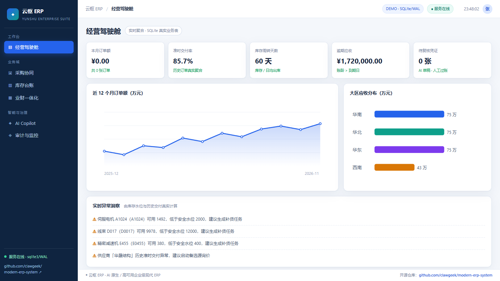

# 云枢 ERP · Yunshu ERP

> **AI 原生 + 高可用企业级现代 ERP 的真实业务实现**
> 开源地址：**https://github.com/clawgeek/modern-erp-system** （Public）
> 讲解视频：[docs/云枢ERP_项目讲解_1080p.mp4](docs/云枢ERP_项目讲解_1080p.mp4) · 1920×1080 / 5 分钟 / 中英字幕



---

## 真实业务实现

这是一个可部署、可测试、能跑通完整业务闭环的工程实现：

- 真数据库：SQLite（WAL 模式），14 张业务表、12 个物料、8 个供应商、历史订单/应收/凭证种子数据；
- 真事务：一次「收货入库」在同一个数据库事务里完成 **库存更新 + 库存流水 + 凭证草稿生成 + 订单状态流转 + 审计留痕**，任一步失败整体回滚；
- 真 API：16 个 REST 接口，全部读写真实表，支持 `Idempotency-Key` 幂等；
- 真规则：AI 只产出「建议」，硬规则对借贷平衡、预算额度、分摊权重、重复过账有一票否决权；
- 真治理：每个写操作写 `audit_logs`，带 `trace_id`、操作人、前后快照；高风险动作强制人工复核；
- 零第三方依赖：只用 Python 标准库，前端原生 JS，无需 `npm install`、无需构建。

---

## 快速开始（30 秒）

```bash
git clone https://github.com/clawgeek/modern-erp-system.git
cd modern-erp-system
python server.py                      # Python 3.9+
```

浏览器打开 **http://127.0.0.1:8766** ，或：

```bash
curl http://127.0.0.1:8766/api/health
./deploy.sh check                     # 健康检查 + 业务冒烟
python tests/test_api.py              # 7 组真实接口测试
```

Docker 部署（含健康检查与数据卷持久化）：

```bash
docker compose up -d --build
docker compose ps
curl http://127.0.0.1:8766/api/health
```

其它：`python server.py --port 8080` 指定端口；`python server.py --reset` 重置数据库。

---

## 业务闭环（可在界面上点完）

```
① AI 推荐供应商   POST /api/ai/recommend
      ↓ 人工确认（建议态，不落库）
② 创建采购订单   POST /api/orders              → orders 表 CONFIRMED + 审计
      ↓
③ 收货入库       POST /api/orders/{id}/receive
                  ├─ inventory.qty += 760
                  ├─ inventory_ledger 流水
                  ├─ vouchers + voucher_lines 凭证草稿（借贷平衡）
                  ├─ orders.status = RECEIVED
                  └─ audit_logs（一次原子事务）
      ↓ 人工复核
④ 凭证过账       POST /api/vouchers/{no}/approve
                  └─ 硬规则校验借贷平衡 → POSTED → 审计日志
      ↓
⑤ AI Copilot     POST /api/copilot            → 自然语言 → 真实查询 / 任务编排
```

界面对应六个视图：经营驾驶舱、采购协同、库存台账、业财一体化、AI Copilot、审计与监控。所有数字都从数据库实时聚合，不是写死的演示数据。

---

## REST API

| 方法 | 路径 | 说明 |
|---|---|---|
| GET | `/api/health` | 健康检查、表数量、运行时计数 |
| GET | `/api/dashboard` | KPI、12 个月订单额、大区应收、实时异常 |
| GET | `/api/materials` `/api/suppliers` | 主数据 |
| GET | `/api/orders` `/api/inventory` `/api/vouchers` | 业务单据（凭证含分录） |
| GET | `/api/audit` `/api/events` `/api/metrics` | 审计日志、事件流、运行时指标 |
| POST | `/api/ai/recommend` | 供应商可解释加权评分 Top3 |
| POST | `/api/ai/voucher-suggest` | 业务语义 → 科目/分摊 → 凭证草稿 |
| POST | `/api/copilot` | 自然语言 → 工具编排 → 真实查询 |
| POST | `/api/orders` | 创建采购订单（预算硬规则 + 幂等） |
| POST | `/api/orders/{id}/receive` | 收货入库原子事务 |
| POST | `/api/vouchers/{no}/approve` | 凭证复核过账（借贷平衡硬规则） |

请求示例：

```bash
curl -X POST http://127.0.0.1:8766/api/ai/recommend \
  -H "Content-Type: application/json" \
  -d '{"sku":"A1024","qty":760}'

curl -X POST http://127.0.0.1:8766/api/orders \
  -H "Content-Type: application/json" -H "Idempotency-Key: demo-001" \
  -d '{"sku":"A1024","qty":760,"supplier_id":"SUP-01"}'
```

---

## 架构与选型映射

| 生产级选型 | 本仓库可运行实现 | 生产替换路径 |
|---|---|---|
| MySQL 8.0 MGR 半同步 / TiDB | SQLite WAL + 严格事务 | 换成 MySQL MGR / TiDB，业务层不变 |
| Spring Boot 3 + Nacos/Sentinel | Python 标准库 HTTP 服务 + 路由分发 | 领域服务拆分为 12 个微服务 |
| Kafka/RocketMQ 事务消息 + Saga | `events` 事件表 + 原子事务 | 换事务消息 + 对账任务 |
| Flink CDC → Doris 实时 OLAP | 实时 SQL 聚合 `/api/dashboard` | 换 Flink CDC + Doris |
| 私有 Qwen3/DeepSeek + vLLM 网关 | 可解释加权评分 + 语义规则（可替换） | 接模型网关，保持「建议态」契约 |
| Drools 硬规则一票否决 | `approve_voucher` / 预算 / 权重校验 | 换规则中心，接口契约不变 |
| 同城双活 + 异地灾备 | 单容器 + healthcheck + 数据卷 | 多副本 + 网关切流 |
| OTel + Prometheus 可观测 | `/api/health` + `/api/metrics` + 审计日志 | 接 OTel/Prometheus |

**设计取舍**：本仓库保证「业务逻辑真实、事务真实、可一键部署」，用 SQLite 换掉分布式数据库，是为了让任何人 30 秒内跑起来。生产环境的目标指标为 SLO 99.99%、账务 RPO=0、同城 RTO<15min；接口与领域边界保持一致，可直接替换基础设施层。

---

## AI 治理（为什么不让大模型直接写账）

1. **稳定内核 + 智能外壳**：账务/库存/订单由确定性事务写入，AI 只返回建议或草稿。
2. **神经符号双轨**：LLM/启发式评分做柔性判断（科目、分摊、供应商），硬规则做刚性校验（借贷平衡、税码、额度、期间、权限）。
3. **六步闸门**：意图 → 规划 → 取数带引用 → 硬规则校验 → 人工审批 → 执行/凭证/审计。
4. **置信度闸门**：低于阈值或高风险动作一律挂起，禁止自动过账、自动下单、自动付款。
5. **全链路可追溯**：`audit_logs` 记录动作、操作人、`trace_id` 与前后快照；Copilot 每次工具调用都留痕。

---

## 目录结构

```
modern-erp-system/
├── server.py                 # HTTP 入口（标准库 ThreadingHTTPServer）
├── erp_core.py               # 业务内核：Schema / 种子 / 事务 / AI 建议 / 路由
├── public/
│   ├── index.html            # 六视图 SPA 外壳
│   ├── styles.css            # 企业级浅色主题
│   └── app.js                # 真实 API 交互 + ?demo=1 逐帧录制模式
├── tests/test_api.py         # 起真实服务跑 7 组业务测试
├── Dockerfile                # python:3.12-slim + HEALTHCHECK
├── docker-compose.yml        # 数据卷持久化 + 健康检查 + 自动重启
├── deploy.sh                 # local / docker / check 三种模式
├── docs/
│   ├── 现代ERP系统设计说明书.md   # 架构与高可用选型说明
│   ├── 云枢ERP_项目讲解_1080p.mp4   # 5 分钟 1080p 讲解视频
│   ├── 云枢ERP_项目讲解_中英字幕.srt
│   └── preview.png                  # 运行界面截图
└── README.md
```

## 测试覆盖

`python tests/test_api.py` 会在临时数据库上启动真实服务并验证：健康检查与种子数据、驾驶舱真实聚合、AI 推荐排序、订单创建幂等与非法入参、收货入库的库存增量与重复收货 409、凭证借贷硬规则与重复过账 409、Copilot 工具编排、审计日志留痕。

## 许可

MIT License.
